# 실물 평가 — 1200판 모델 · 200판 모델 단계 평가 (FAIRINO FR5, 2026-11-12 · 11-15)

> - 과제: FR5가 빨간 튜브를 집어 빨간 링으로 표시한 빈 받침 구멍에 꽂기 (지시문 `put the red tube in the red slot`)
> - 모델: GR00T N1.7 미세조정 두 개
>   - **1200판** — 실물 자동 시연 200판 × 3 + 시뮬 600판
>   - **200판** — 실물 자동 시연 200판, 영상 색 · 밝기 증강
> - 평가: 배치 L1–L10, 배치마다 유효 3판, 판마다 처음 막힌 단계(S1–S9)를 정함
> - 자료: 실행 기록(손끝 위치 · 그리퍼 폭 10 Hz, 그리퍼 사건, 시작 · 끝 장면 인식), 사람 판정, 실행 영상(200판 날)
> - 평가 단계표는 FR3 결과([BioRoboticsMVLAFranka](https://github.com/SungjinDavidLee/BioRoboticsMVLAFranka))의 S0–S9를 FR5 기록에 맞춰 썼다(4절).

**English summary.** Two GR00T N1.7 policies fine-tuned for a FAIRINO FR5 tube-insertion task were each run 30 times on ten layouts (L1–L10, three valid trials per layout) and scored stage by stage (S9 = the red tube is inserted into the red-ringed slot, by human judgement). **1200** — 200 scripted real demonstrations repeated three times plus 600 simulated ones: 16/30 (53%, Wilson 95% CI 36–70%). **200** — the same 200 real demonstrations alone, with colour/brightness augmentation: 12/30 (40%, 25–58%). The difference is not significant (Fisher p = 0.44). Both models reached and grasped the red tube at almost the same rate (S4 19 vs 18 of 30) and every grasped tube was lifted and carried to within about 20 mm of the slot; the gap came from the last step (inserted 16/19 vs 12/18, p = 0.27). Both failed on L3 (the gripper closed nearer the yellow tube in 5 of 6 trials) and L10. The two runs were on different days and the racks were placed by hand from photos, so the same layout number differed by 8–60 mm (tube) and 9–88 mm (slot) between the two days; per-layout comparisons are therefore not paired.

**과제 한 판 — 평가표 단계로 본 네 장면: S0 초기 위치 · S4 쥐기 · S8 이송 · S9 꽂힘**

200판 모델의 L9-1 성공 판입니다. 사진 위 설명에 그 단계의 판정 기준(4.1절)과 이 판에서 잰 값을 적었습니다. 사진은 실행 영상(3인칭 | 손목, 848×480 × 2)에서 잘랐습니다.

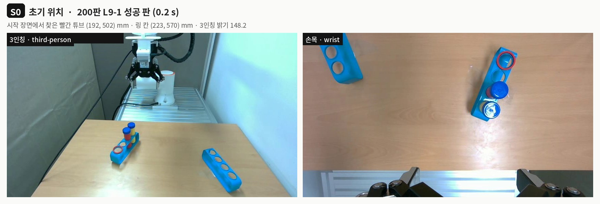

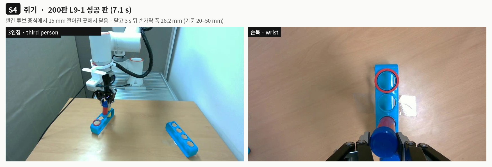

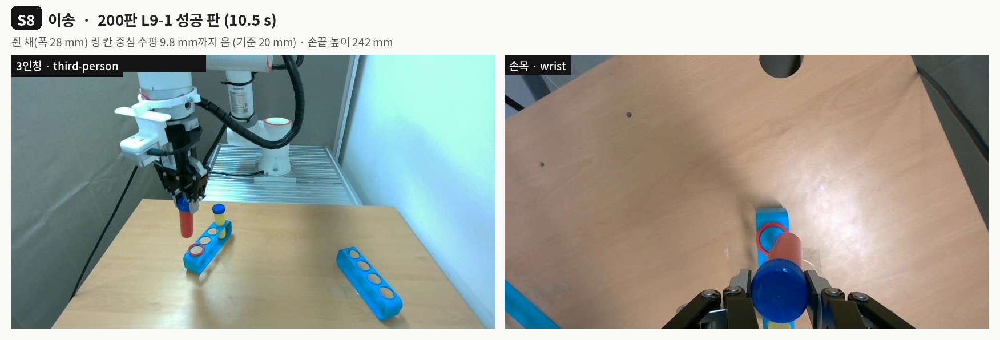

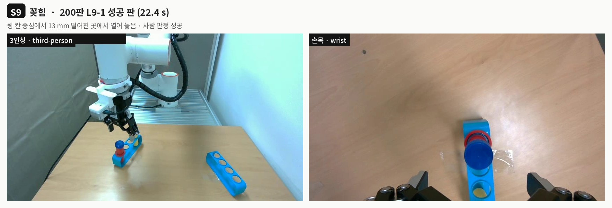

---

## 1. 요약

| 모델 | 학습 데이터 | 평가일 | 판 수 | 성공 (Wilson 95%) | 부분 | 실패 |
|---|---|---|---|---|---|---|
| 1200판 | 실물 200판 × 3 + 시뮬 600판 | 2026-11-12 | 30 | **16 (53%, 36–70%)** | 3 | 11 |
| 200판 | 실물 200판 (색 · 밝기 증강) | 2026-11-15 | 30 | **12 (40%, 25–58%)** | 6 | 12 |

- 최종 성공은 1200판이 4판 많다. 차이는 통계적으로 확인되지 않는다(Fisher p = 0.44).
- 쥐기까지는 거의 같았다.
  - S1 목표 선택 25 vs 26, S2 접근 22 vs 22, S4 쥐기 19 vs 18 (30판 중)
  - 쥔 판은 두 모델 모두 전부 들어 올려 링 칸 근처(쥔 채 수평 20 mm 안)까지 옮겼다(S6 · S8 통과 19/19, 18/18).
- 차이는 꽂기(S9)에서 났다. 링 칸까지 옮긴 판 중 꽂힌 판은 1200판 16/19 (84%), 200판 12/18 (67%)이다(p = 0.27).
  - 200판의 꽂기 실패 6판: 얹힘 · 덜 꽂힘 4판, 칸 위에서 튜브를 놓침 2판
- 두 모델이 같이 약한 배치가 있다.
  - L3: 6판 중 5판이 노란 튜브 쪽에서 닫았다. 두 모델 모두 0/3.
  - L10: 두 모델 모두 0/3. 1200판은 3판 모두 노란 튜브 쪽, 200판은 노란 튜브 1판 · 25 mm 밖에서 닫음 1판 · 덜 꽂힘 1판.
- 200판만 0/3인 배치는 L6(빨간 튜브 중심에서 17–25 mm 떨어진 곳에서 닫아 헛잡음)과 L8(30–38 mm)이다.
- **두 평가는 날짜가 다르고, 같은 배치 번호라도 실제로 놓인 자리가 다르다**(3.3절). 빨간 튜브 8–60 mm, 링 칸 9–88 mm 차이가 났다. 그래서 배치별 비교는 짝 비교가 아니다.

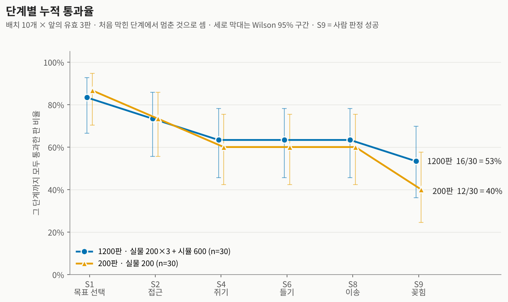

---

## 2. 실행 영상

200판 모델 평가(11-15)의 영상입니다. 3배속 미리보기이고, 판 이름을 누르면 실제 속도 영상(mp4, 3인칭 + 손목, 10 fps)이 열립니다. 아래 막대는 진행 단계(접근 · 쥐고 옮기기 · 놓기)와 지금 시각입니다.

| 성공 — [L9-1](media/200_L9-1_success.mp4) (33 s) | 성공 — [L4-1](media/200_L4-1_success.mp4) (35 s) |
|---|---|
| 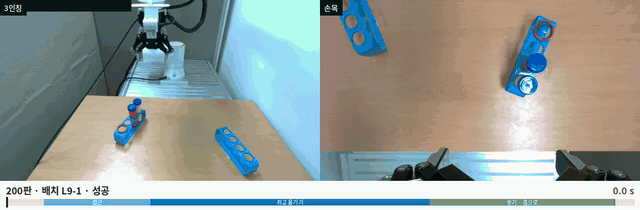 | 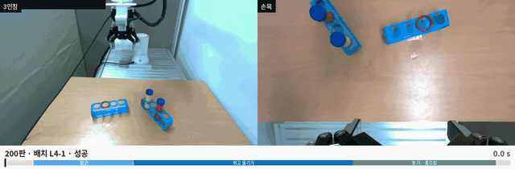 |
| **실패 · 노란 튜브 — [L3-1](media/200_L3-1_wrong_tube.mp4) (38 s)** | **실패 · 헛잡음 — [L6-1](media/200_L6-1_grasp_miss.mp4) (16 s)** |
| 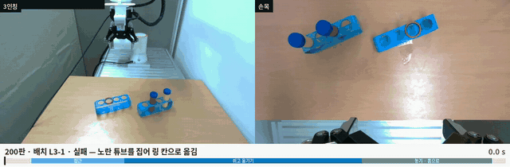 | 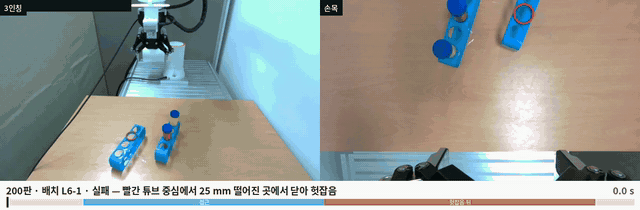 |

- L9-1은 빨간 튜브와 링 칸이 같은 받침에 있는 배치다. L4-1은 다른 받침으로 약 240 mm 옮겼다.
- L3-1은 노란 튜브를 집어 링 칸에 넣었다(S1 실패). 같은 배치의 L3-2도 같았다.
- L6-1은 빨간 튜브 중심에서 25 mm 떨어진 곳에서 닫아 빈손이 됐다. L6은 3판 모두 같은 쪽으로 17–25 mm 벗어났다(5.3절).

1200판 평가(11-12)는 영상 녹화를 하지 않아 시작 · 끝 장면 사진만 있습니다.

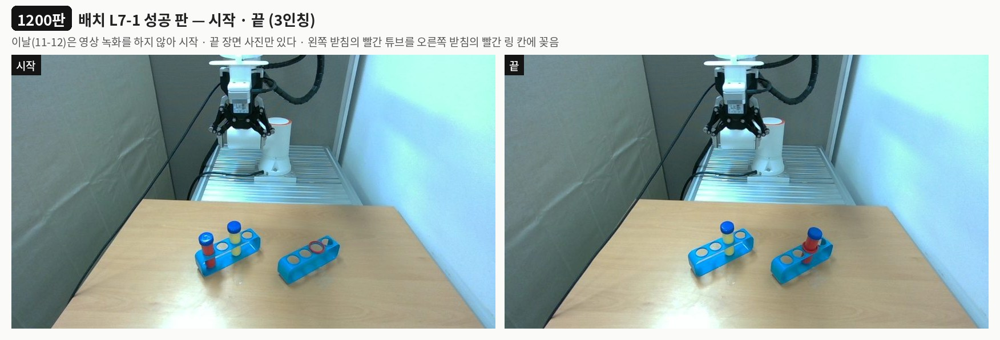

---

## 3. 실험 구성

### 3.1 모델과 학습

| | 1200판 | 200판 |
|---|---|---|
| 기반 모델 | GR00T N1.7 (3B) | 같음 |
| 학습 데이터 | 실물 200판 × 3 + 시뮬 600판 = 1,200판, 246,739 프레임 (실물 프레임 53%) | 실물 200판, 43,768 프레임 |
| 실물 데이터 | FR5 자동 시연 수집기로 모은 200판 (10 Hz, 3인칭 · 손목 영상 + 손끝 상태) | 같은 200판 |
| 시뮬 데이터 | 실물 높이(잡는 손끝 높이 131 mm)에 맞춰 다시 모은 600판, 손목을 70° 넘게 돌리는 판 제외 | — |
| 영상 증강 | 없음 | 밝기 0.2 · 대비 0.2 · 채도 0.5 · 색조 0.05 |
| 스텝 · 배치 | 20,000 스텝, 배치 64 (GPU 1개 × 64) | 20,000 스텝, 배치 64 (GPU 2개 × 32) |
| 에폭 | 약 5.2 (실물 프레임은 3번 들어 있어 약 15.6번 봄) | 약 29.2 |
| 학습 부분 | 프로젝터 · 행동 헤드(diffusion) · VL LayerNorm. 언어 · 영상 백본은 고정 | 같음 |
| 그 밖 | lr 1e-4 코사인(예열 5%), weight decay 1e-5, grad clip 1.0, 상태 dropout 0.2, seed 42 | 같음 |
| 마지막 학습 손실 | 0.0103 | 0.0075 |

- 두 모델은 데이터만 다른 것이 아니다. 영상 증강 유무와 GPU 구성(배치 크기는 같음)도 다르다. 이 평가로 시뮬 데이터의 효과만 따로 말할 수 없다.
- 검증 세트는 두지 않았고, 두 모델 모두 20,000 스텝 체크포인트 하나만 평가했다.

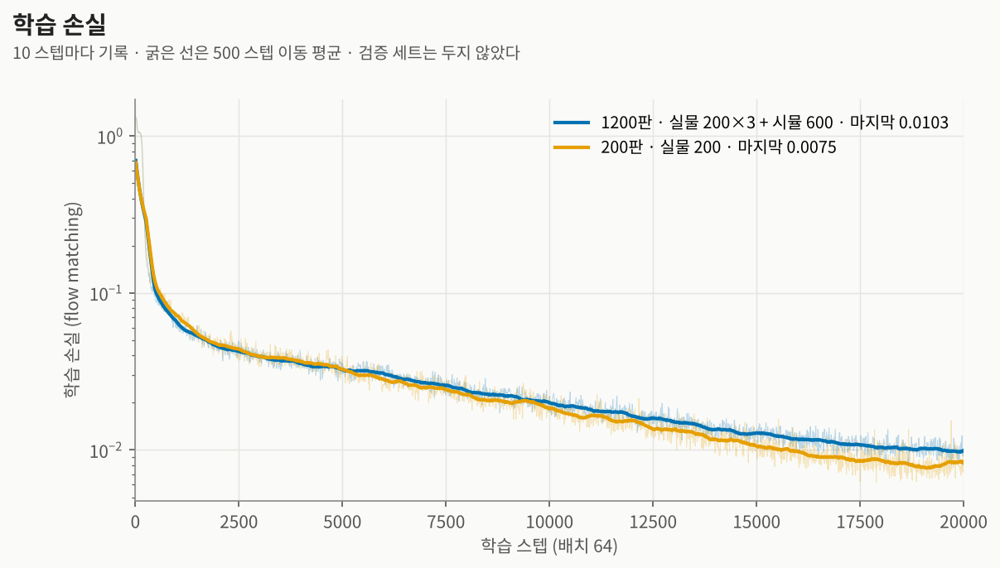

### 3.2 실행 조건

| 항목 | 값 (두 평가 같음) |
|---|---|
| 로봇 | FAIRINO FR5 (6축), DH AG-160-95 그리퍼, 3인칭 · 손목 카메라 848×480 (정책 입력 256×256) |
| 지시문 | `put the red tube in the red slot` |
| 행동 | 한 번에 16개(손끝 위치 · 자세 + 그리퍼)를 받아 앞 8개를 실행하고 다음을 묻는다. 묶음 사이 6 스텝 섞기, 속도 배율 1.0 |
| 정책 서버 | GPU 서버, 로봇 실행 컴퓨터와 SSH 터널로 연결. 한 번 묻고 받는 왕복 시간 중간값 1200판 307 ms · 200판 280 ms |
| 안전장치 | 손끝 높이 하한 125 mm(학습 데이터의 잡는 높이는 131 mm), 한 스텝 30 mm · 8° 한계. 한계를 넘는 행동 묶음은 버리고 3번 연속이면 멈춤 |
| 끝 조건 | 놓고 2.5 s 뒤, 또는 120 s |
| 실행 프로그램 | 같은 판(v6.6d)으로 센 판 60개 모두 실행 |
| 3인칭 화면 밝기 (판 시작) | 1200판 147.9–166.0 (기록 있는 27판), 200판 146.8–150.3. 학습 영상 약 150 |

### 3.3 평가 배치 — 두 날의 실제 자리

평가 배치 L1–L10은 1200판 평가 날 판마다 무작위로 정해 사진으로 남겼고, 200판 평가 날에는 그 사진을 보고 받침과 튜브를 손으로 다시 놓았다. 아래는 두 날 첫 판의 시작 장면이다.

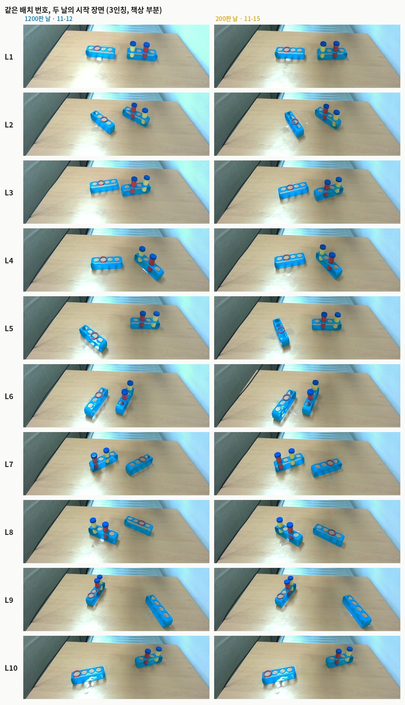

두 날 시작 장면에서 인식한 자리(배치마다 센 판의 가운데값)의 차이:

| 배치 | L1 | L2 | L3 | L4 | L5 | L6 | L7 | L8 | L9 | L10 |
|---|---|---|---|---|---|---|---|---|---|---|
| 빨간 튜브 (mm) | 9 | 9 | 24 | 60 | 59 | 26 | 36 | 33 | 13 | 36 |
| 링 칸 (mm) | 21 | 13 | 36 | 46 | 52 | – | 36 | 72 | 9 | 88 |

- 1200판 날은 판마다 시작 장면의 빨간 튜브 자리가 그날 사진과 0–2 mm(L9 약 9 mm)로 맞았다.
- 200판 날 빨간 튜브 자리가 15 mm 안으로 맞은 배치는 L1 · L2 · L9뿐이다. L5는 링 칸 받침의 방향이, L10은 링 칸 받침의 자리가 크게 달랐다(사진).
- L6 링 칸은 200판 날 시작 · 끝 장면에서 인식되지 않았다.

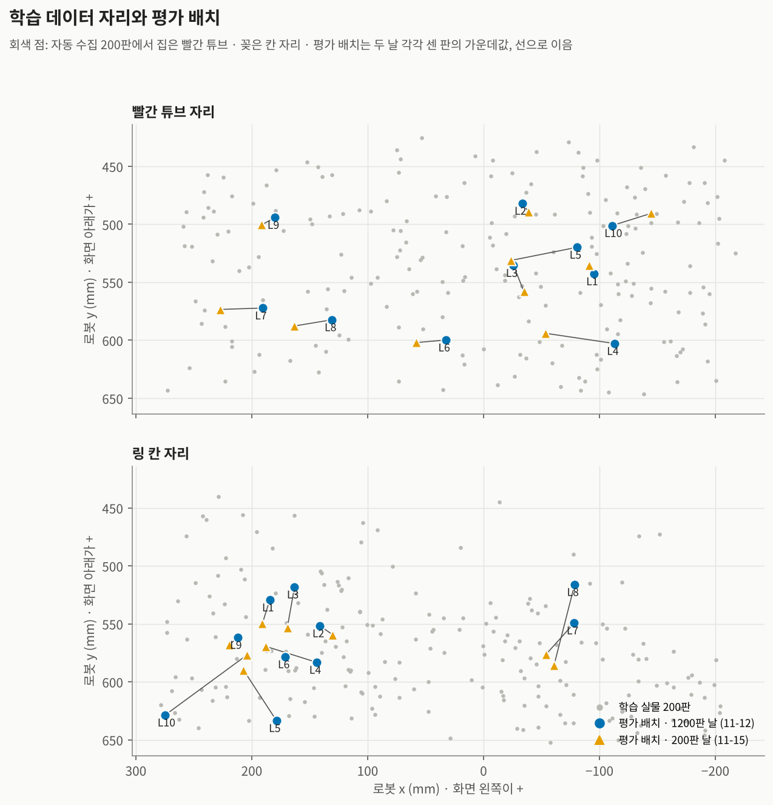

- 회색 점은 학습 실물 200판에서 빨간 튜브를 집은 자리와 꽂은 칸 자리다. 평가 배치는 모두 이 범위 안에 있다.
- 평가 배치의 빨간 튜브에서 가장 가까운 학습 판까지는 1200판 날 3–19 mm, 200판 날 4–25 mm다. 200판 날 L8이 25 mm로 가장 멀다. 배치별 값은 [`data/layouts.csv`](data/layouts.csv)에 있다.

---

## 4. 평가 방법

### 4.1 단계 (FR5 기준값)

분류: G = S1, P = S2–S6, T = S7–S8, L = S9. FR3 평가표의 단계 이름을 그대로 쓰고, FR5 실행 기록으로 판정할 수 있는 여섯 단계(S1 · S2 · S4 · S6 · S8 · S9)만 판정했다.

| 단계 | 분류 | Sub-task | 이 문서의 판정 (FR5 기준값) |
|---|---|---|---|
| S0 | — | 초기 상태 · 센서 · 보정 | 판정하지 않고 보고만 함: 무효 판 수와 사유, 시작 장면 인식, 3인칭 밝기 |
| S1 | G | 목표 튜브 선택 | 처음 닫은 자리가 노란 튜브보다 빨간 튜브 중심에 가까움 (닫지 않았으면 높이 170 mm 아래에서 가장 가까이 간 튜브) |
| S2 | P | 목표 튜브 접근 | 닫기 전 손끝이 빨간 튜브 중심 수평 25 mm 안 · 높이 170 mm 아래로 들어감 |
| S3 | P | Pre-grasp 정렬 | 따로 판정하지 않음 (S2 · S4로 나뉨) |
| S4 | P | 접촉 · 쥐기 | 처음 닫고 3 s 뒤 손가락 폭 20–50 mm (튜브 지름 28.6 mm) |
| S5 | P | 안정 파지 | 따로 판정하지 않음 (S6의 "쥔 채"에 들어 있음) |
| S6 | P | 들어 올리기 | 쥔 채(폭 12 mm 이상) 닫은 높이보다 60 mm 이상 올라감 |
| S7 | T | 받침에서 이탈 | 따로 판정하지 않음 |
| S8 | T | 링 칸까지 이송 | 쥔 채(폭이 처음 12 mm 아래로 떨어지기 전까지) 손끝이 링 칸 중심 수평 20 mm 안에 들어감 |
| S9 | L | 정렬 · 꽂기 | 사람 판정 성공 (빨간 튜브가 빨간 링 칸에 꽂힘) |

### 4.2 채점 규칙

1. 판마다 처음 막힌 단계 하나를 정한다. 표의 통과 수는 누적이다.
2. 뒤 단계를 통과했으면 앞 단계도 통과로 센다. 예를 들어 성공 판은 쥔 채 링 칸까지 거리가 20 mm를 조금 넘어도 S8 통과다(1200판 2판, 20.6 · 26.2 mm).
3. S1을 못 하면(노란 튜브를 잡거나 그쪽에서 닫음) 뒤 단계는 모두 실패다. 노란 튜브를 링 칸에 넣은 판도 같다.
4. 튜브 · 링 칸 자리는 그 판의 시작 장면 인식값(3인칭 카메라 + 자동 수집기 보정)이다. 링 칸을 시작 장면에서 못 찾으면 끝 장면 → 그날 배치 사진(1200판 날만) → 같은 날 같은 배치 다른 판의 가운데값 순으로 썼다(`data/trials.csv`의 `ring_src`). 빨간 튜브 시작 자리 20 mm 안에서 찾은 링은 잘못 찾은 것으로 보고 버렸다.
5. 배치마다 앞의 유효 3판만 센다. 그 뒤에 더 돌린 판(200판 5판)은 따로 적는다(5.4절).
6. 운영자가 무효로 표시한 판은 통계에서 뺐다(5.6절).
7. 사람 판정은 성공 · 부분 · 실패다. 부분은 튜브를 링 칸까지 가져갔지만 끝까지 꽂히지 않은 판(얹힘 · 덜 꽂힘 · 칸 위에서 놓침)이다.

---

## 5. 결과

### 5.1 단계별 누적 통과

| 단계 | 1200판 | 200판 | Fisher p |
|---|---|---|---|
| S1 목표 선택 | 25/30 (83%) | 26/30 (87%) | 1.00 |
| S2 접근 | 22/30 (73%) | 22/30 (73%) | 1.00 |
| S4 쥐기 | 19/30 (63%) | 18/30 (60%) | 1.00 |
| S6 들기 | 19/30 (63%) | 18/30 (60%) | 1.00 |
| S8 이송 | 19/30 (63%) | 18/30 (60%) | 1.00 |
| **S9 꽂힘 (성공)** | **16/30 (53%)** | **12/30 (40%)** | 0.44 |

단계 전환 (앞 단계를 통과한 판 중 이 단계를 통과한 비율):

| 단계 | 1200판 | 200판 |
|---|---|---|
| S1 | 25/30 | 26/30 |
| S2 | 22/25 | 22/26 |
| S4 | 19/22 | 18/22 |
| S6 | 19/19 | 18/18 |
| S8 | 19/19 | 18/18 |
| S9 | **16/19** | **12/18** |

### 5.2 처음 막힌 단계

| 처음 막힌 단계 | 1200판 | 200판 |
|---|---|---|
| S1 노란 튜브 쪽 | 5 (L3 × 2, L10 × 3) | 4 (L3 × 3, L10-1) |
| S2 빨간 튜브 25 mm 안으로 못 감 | 3 (L3-2, L8-3, L9-1) | 4 (L8 × 3, L10-3) |
| S4 헛잡음 | 3 (L5-1, L5-3, L6-1) | 4 (L6 × 3, L9-3) |
| S6 · S8 | 0 | 0 |
| S9 꽂지 못함 | 3 (L2-1, L4-1, L8-2) | 6 (L1-2, L2-1, L2-3, L4-2, L5-3, L10-2) |
| 성공 | 16 | 12 |

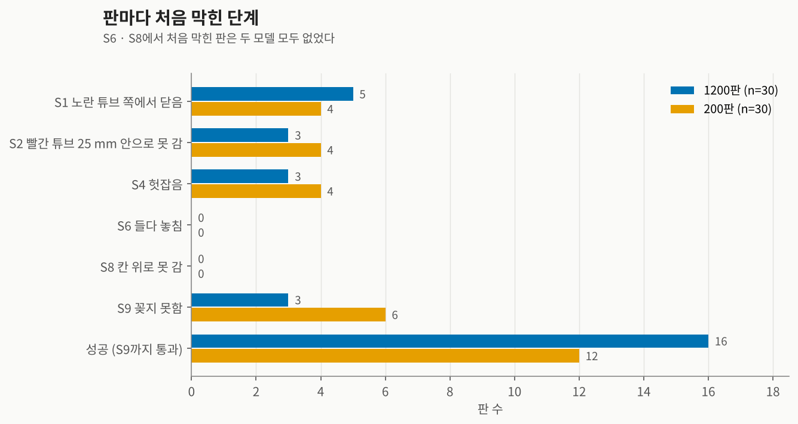

- 잡기 전(S1–S4) 실패는 11판 대 12판으로 같다.
- 노란 튜브 쪽 9판 중 실제로 노란 튜브를 쥐고 옮긴 판은 1200판 L10-2, 200판 L3-1 · L3-2 · L10-1이다. 나머지는 노란 튜브 근처에서 빈손으로 닫았다.
- 200판의 S9 실패 6판:
  - 얹힘 · 덜 꽂힘 4판 (L1-2, L2-1, L4-2, L10-2). 놓은 자리는 링 칸 중심에서 13–19 mm였다.
  - 칸 위에서 튜브를 놓침 2판 (L2-3, L5-3). 쥔 채 링 칸 11 mm 안까지 갔다가, 내려가는 도중 손끝 160–169 mm에서 손가락 폭이 0으로 떨어졌다(성공 판은 손끝 142–155 mm에서 열었다).
- 1200판의 S9 실패 3판(L2-1, L4-1, L8-2)은 모두 부분(얹힘 · 덜 꽂힘)이다.

### 5.3 처음 닫은 자리

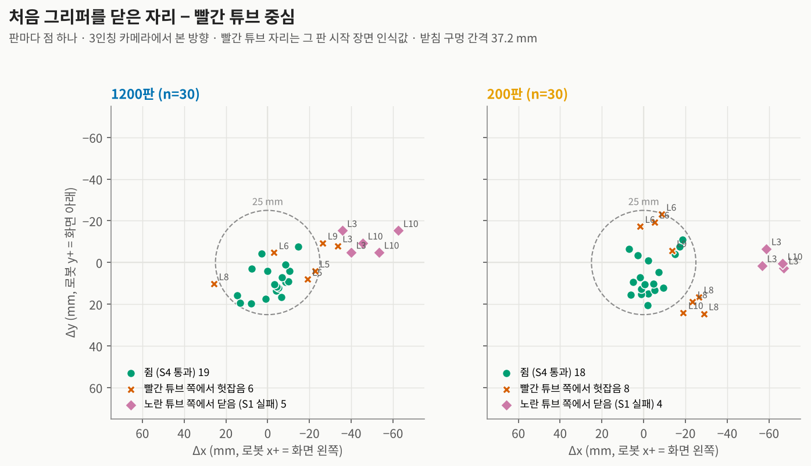

- 쥔 판은 빨간 튜브 중심에서 1200판 4–23 mm(가운데값 12.7), 200판 3–22 mm(13.5) 떨어진 곳에서 닫았다. 손가락이 튜브를 따라 닫히며 맞춰지는 폭이다.
- 헛잡은 14판은 빨간 튜브 중심에서 15–38 mm 떨어진 곳에서 닫았다. 예외는 1200판 L6-1(5.6 mm에서 닫았는데 빈손)이고, 이 판은 기록으로 원인을 가리지 못했다.
- 같은 배치의 헛잡음은 방향이 같다.
  - 200판 L6: 3판 모두 화면 위쪽(로봇 −y, 카메라에서 먼 쪽)으로 17–23 mm
  - 200판 L8: 3판 모두 화면 오른쪽 아래로 30–38 mm. 이 배치는 빨간 튜브에서 가장 가까운 학습 판이 25 mm로, 평가 배치 중 가장 멀다.
  - 1200판 L5: 2판 모두 화면 오른쪽(로봇 −x)으로 21–23 mm
- 노란 튜브 쪽에서 닫은 판(보라)은 빨간 튜브에서 39–67 mm, 노란 튜브에서 12–37 mm였다.

### 5.4 배치별 성공

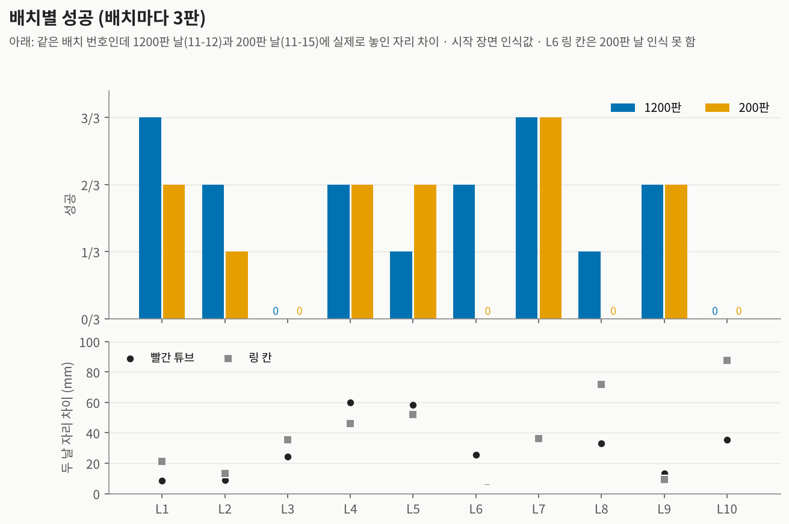

| 배치 | L1 | L2 | L3 | L4 | L5 | L6 | L7 | L8 | L9 | L10 | 합 |
|---|---|---|---|---|---|---|---|---|---|---|---|
| 1200판 | 3/3 | 2/3 | 0/3 | 2/3 | 1/3 | 2/3 | 3/3 | 1/3 | 2/3 | 0/3 | 16/30 |
| 200판 | 2/3 | 1/3 | 0/3 | 2/3 | 2/3 | 0/3 | 3/3 | 0/3 | 2/3 | 0/3 | 12/30 |

- 두 날 빨간 튜브 자리가 15 mm 안으로 맞은 L1 · L2 · L9만 보면 1200판 7/9, 200판 5/9다.
- 센 판 뒤에 더 돌린 200판 5판(통계에서 뺌):
  - L6을 다시 놓고 3판 더 돌림(빨간 튜브 자리가 처음 L6에서 약 41 mm 옮겨짐): 3판 모두 헛잡음, 빨간 튜브 중심에서 21–31 mm
  - L2-4 부분, L10-4 헛잡음

### 5.5 단계별 정량 지표 (가운데값, 괄호는 최소–최대)

| 단계 | 지표 | 1200판 | 200판 |
|---|---|---|---|
| S4 | 쥔 판의 닫은 자리 → 빨간 튜브 중심 (mm) | 12.7 (4.1–23.4) | 13.5 (2.5–21.5) |
| S4 | 쥔 판의 닫은 높이 (mm, 학습 131) | 132.4 (126.1–141.4) | 133.9 (127.7–143.6) |
| S4 | 닫은 시각 (s, 시작부터) | 6.7 (5.4–8.4) | 6.8 (5.6–7.8) |
| S4 | 닫고 3 s 뒤 손가락 폭 (mm) | 28.2 (27.7–28.7) | 28.1 (26.9–28.3) |
| S6 | 쥔 채 들어 올린 높이 (mm) | 120.0 (102.7–148.8) | 116.0 (105.6–131.9) |
| S8 | 쥔 채 링 칸 중심까지 가장 가까운 거리 (mm) | 8.3 (1.3–26.2) | 9.7 (0.5–16.2) |
| S9 | 성공 판의 연 자리 → 링 칸 중심 (mm) | 13.4 (6.3–31.6) | 13.1 (6.6–19.3) |
| — | 성공 판 걸린 시간 (s) | 27.9 (22.6–30.4) | 26.0 (23.2–35.6) |

- 링 칸 자리는 시작 장면 인식값이라 실제 구멍 중심과 몇 mm 다를 수 있다. 1200판 L7-3은 인식한 링 칸에서 31.6 mm 옆에서 열었는데 튜브가 칸에 들어갔다(운영자 확인).

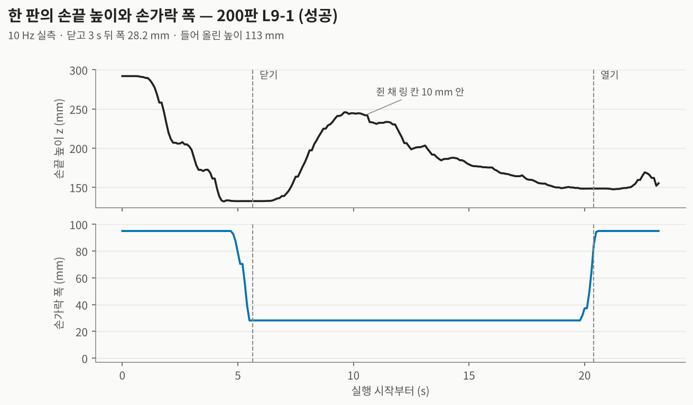

### 5.6 무효 판

| 사유 | 1200판 | 200판 |
|---|---|---|
| 배치 실수 (사진과 다른 배치로 시작, 배치 번호 틀림) | 4 | 2 |
| 3인칭 밝기 약 186 (학습 약 150) | 3 | 0 |
| 로봇 · 그리퍼가 명령을 따라오지 않아 실행 프로그램이 멈춤 | 2 | 2 |
| 배치당 3판을 넘겨 영상용으로 돌린 판 | 0 | 1 |
| 운영자가 무효로 표시, 사유 기록 없음 | 5 | 6 |
| 합 | 14 | 11 |

- 무효 판은 그 배치를 다시 돌려 유효 3판을 채웠다.
- 1200판 날 밝기 186 구간의 L1 3판은 무효로 하고, 햇빛을 가려 3인칭 밝기를 170 아래로 낮춘 뒤 L1부터 다시 돌렸다.

---

## 6. 모델별 분석

### 6.1 1200판 — 실물 200판 × 3 + 시뮬 600판

- 성공 16/30 (53%).
- 쥔 19판은 모두 들어 링 칸까지 옮겼고, 그중 16판이 꽂혔다. 나머지 3판은 얹힘 · 덜 꽂힘이다.
- 실패는 대부분 잡기 전에 났다(11판).
  - 노란 튜브 쪽: L3 2판, L10 3판. L10-2는 노란 튜브를 쥐고 링 칸까지 옮겼다.
  - 빨간 튜브 25 mm 안으로 못 감: 3판 (28–34 mm에서 닫음)
  - 헛잡음: 3판 (L5 2판 21–23 mm, L6-1 5.6 mm)
- L1 · L7은 3/3, L3 · L10은 0/3이다.

### 6.2 200판 — 실물 200판 (색 · 밝기 증강)

- 성공 12/30 (40%).
- 잡기 전 실패 12판으로 1200판(11판)과 비슷하지만, 몰린 배치가 다르다.
  - 노란 튜브 쪽: L3 3판(2판은 노란 튜브를 링 칸에 넣음), L10-1(노란 튜브를 링 칸에 덜 꽂음)
  - 빨간 튜브 25 mm 안으로 못 감: L8 3판(30–38 mm), L10-3(31 mm)
  - 헛잡음: L6 3판(17–25 mm, 같은 방향), L9-3(15 mm)
- 쥔 18판은 모두 들어 링 칸 근처까지 옮겼다. 그중 12판이 꽂혔다.
  - 꽂기 실패 6판 중 2판은 칸 위에서 튜브가 손가락에서 빠졌다(5.2절). 1200판에는 이런 판이 없었다.
- L7은 3/3, L3 · L6 · L8 · L10은 0/3이다.

---

## 7. 비교

| 비교 | 1200판 | 200판 | Fisher p |
|---|---|---|---|
| 최종 성공 | 16/30 (53%) | 12/30 (40%) | 0.44 |
| 쥐기 (S4) | 19/30 | 18/30 | 1.00 |
| 링 칸까지 옮긴 판 → 꽂힘 (S9 \| S8) | 16/19 (84%) | 12/18 (67%) | 0.27 |
| 두 날 빨간 튜브 자리가 15 mm 안인 L1 · L2 · L9 성공 | 7/9 | 5/9 | 0.62 |

- 두 모델은 쥐기까지 거의 같고, 꽂기에서 1200판이 4판 많다. 어느 비교도 5% 수준에서 유의하지 않다.
- 이 차이를 시뮬 데이터의 효과로 볼 수는 없다.
  - 모델이 데이터 말고도 영상 증강 · GPU 구성 · 에폭 수가 다르다(3.1절).
  - 평가 날짜가 다르고, 같은 배치 번호의 실제 자리가 8–88 mm 달랐다(3.3절).
  - 판 시작 3인칭 밝기는 1200판 날 148–166으로 오르내렸고, 200판 날 147–150으로 고르게 유지됐다.
- 두 모델에 같이 남은 문제는 노란 튜브 쪽으로 가는 배치(L3 · L10)와, 빨간 튜브 중심에서 15–38 mm 떨어진 곳에서 닫는 위치 오차다.
  - L3은 빨간 튜브가 학습 판 6–11 mm 안에 있었는데도 두 모델 모두 노란 튜브 쪽으로 갔다. 학습 데이터와의 거리로는 설명되지 않는다.
  - 위치 오차는 학습 판에서 가장 먼 200판 L8(25 mm)에서 3판 모두 났지만, 13 mm인 200판 L6에서도 3판 모두 났다.

---

## 8. 한계

- 모델마다 30판이다. 이 판 수로는 13%p 차이를 확인할 수 없다(p = 0.44).
- 두 평가는 다른 날 했고, 배치는 사진을 보고 손으로 다시 놓아 같은 배치 번호라도 자리가 달랐다. 배치별 짝 비교가 아니다.
- 두 모델은 학습 데이터 외에 영상 증강 · GPU 구성도 다르다. 한 가지 요인의 효과로 나눌 수 없다.
- S3 · S5 · S7은 따로 판정하지 않았다.
- 튜브 · 링 칸 자리는 3인칭 카메라 인식값이다. 링 칸은 일부 판에서 다른 판 값을 빌렸다(4.2절 4번). 200판 L6은 링 칸 자리가 없다(L6은 모두 S4에서 막혀 판정에는 영향 없음).
- 무효 판 11판(1200판 5 · 200판 6)은 사유 기록이 없다.
- 1200판 평가는 영상이 없어 실패 판의 동작을 기록 수치와 시작 · 끝 사진으로만 봤다.
- 학습에 쓴 배치에서의 성능은 재지 않았다.

---

## 9. 파일

| 경로 | 내용 |
|---|---|
| `README.md` | 이 문서 |
| `data/trials.csv` | 유효 판 65개(센 판 60 + 200판 추가 5, `counted`로 구분): 판정 · 자동 판정 · 단계 통과(S1–S9) · 처음 막힌 단계 · 빨강/노랑/링 칸 자리 · 닫은 자리와 높이 · 연 자리 · 쥔 폭 · 들어 올린 높이 · 링 칸까지 거리 · 걸린 시간 · 왕복 시간 · 밝기 · 그날 배치 사진과의 차이 |
| `data/invalid_trials.csv` | 무효 판 25개 (모델 · 배치 · 자동 판정) |
| `data/stage_summary.json` | 모델별 누적 통과 · 처음 막힌 단계 · 판정 수 |
| `data/layouts.csv` | 배치마다 두 날의 빨강 · 노랑 · 링 칸 자리(가운데값), 두 날 차이, 가장 가까운 학습 판까지 거리 |
| `data/train_positions.csv` | 학습 실물 200판의 빨간 튜브 자리 · 꽂은 칸 자리 |
| `data/train_loss.csv` | 두 모델의 학습 손실 (10 스텝마다) |
| `data/timeline_200_L9-1.csv`, `..._events.json` | 200판 L9-1의 손끝 위치 · 손가락 폭 (10 Hz)과 닫기 · 열기 시각 |
| `figs/task_S0_start.jpg` … `task_S9_place.jpg` | 단계 사진 4장 (200판 L9-1) |
| `figs/fig_stage_cumulative.png` | 단계별 누적 통과율 |
| `figs/fig_first_fail.png` | 처음 막힌 단계 |
| `figs/fig_close_offsets.png` | 처음 닫은 자리 − 빨간 튜브 중심 |
| `figs/fig_layout_success.png` | 배치별 성공과 두 날 자리 차이 |
| `figs/fig_layouts_train.png` | 학습 데이터 자리와 평가 배치 |
| `figs/layout_photos.jpg` | 두 날의 시작 장면 사진 (배치 10개) |
| `figs/fig_train_loss.png` | 학습 손실 |
| `figs/fig_timeline_200_L9-1.png` | 한 판의 손끝 높이 · 손가락 폭 |
| `figs/1200_L7-1_photos.jpg` | 1200판 성공 판 시작 · 끝 사진 |
| `media/200_*.mp4`, `media/200_*_x3.gif` | 200판 실행 영상 4개 (실제 속도 · 3배속) |
| `scripts/score_stages_fr5.py` | 실행 기록 묶음 → `data/` (단계 채점, 배치 · 학습 자료) |
| `scripts/make_figures.py` | `data/` → `figs/fig_*.png` |
| `scripts/make_media.py` | 실행 기록 묶음 · 영상 → `media/`, 단계 사진, 배치 사진, 시간축 자료 |

좌표는 로봇 베이스 기준 mm다. 위치 그림은 3인칭 카메라에서 본 방향(로봇 x+ = 화면 왼쪽, y+ = 화면 아래)으로 그렸다. 판 번호(예: L4-2)는 그 배치의 유효 판 순서다. 실행 기록 묶음과 원본 영상은 이 저장소에 넣지 않았다.
