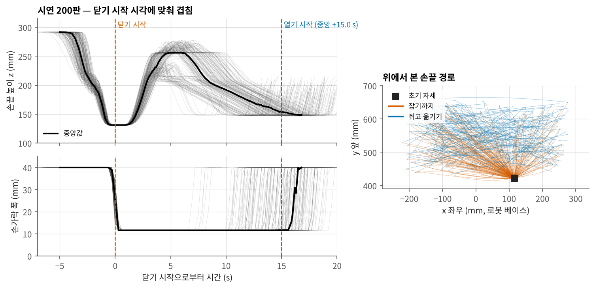

# BioRoboticsRealFR5

실물 FAIRINO FR5로 실험용 튜브를 받침의 지정 칸에 옮겨 꽂는 과제를 다룬다.
자동 수집기로 모은 200판으로 GR00T N1.7을 미세조정하고, 실물 랜덤 배치에서 평가했다.

```
put the red tube in the red slot
```

4구 받침에서 빨간 액체 튜브를 뽑아, 빨간 링으로 표시한 빈 칸에 꽂는다. 같은 받침에 노란 튜브가 하나 더 있다.
튜브 지름은 28.6 mm, 구멍 지름은 30 mm다. 받침 두 개의 자리와 방향, 튜브 칸, 링 칸은 판마다 바뀐다.


---

## 결과

| | |
|---|---|
| 데이터 | 200판 / 43,968 프레임 / 10 Hz, 전부 자동 수집 |
| 정책 | GR00T N1.7 (3B), 20,000 스텝, batch 16, 행동 16개씩 |
| **실물 평가** | **7 / 30 = 23 %** (Wilson 95 % 12–41 %), 랜덤 배치 10개 × 3회 |
| 배치별 | 10개 중 6개에서 성공(2회 성공 1개, 1회 성공 5개), 4개는 세 번 다 실패 |
| 실패 | 잡은 뒤 꽂을 때 칸을 빗나감 약 11회, 잡기 실패 약 11회, 잡은 뒤 실패 1회 |
| 이전 100판 정책 | 0 / 30, 랜덤 배치 |


평가 수치는 운영자가 집계한 값이고, 판별 기록 파일은 없다.

- 같은 과제의 랜덤 배치에서 100판 정책은 0 / 30, 200판 정책은 7 / 30이었다. 두 데이터는 판 수와 배치 분포가 다르다([DATA.md](docs/DATA.md)).
- 200판 정책은 30회 중 약 19회 튜브를 잡았고, 잡은 판 중 7회를 끝까지 꽂았다.
- 성공이 나온 배치 6개의 실패는 대부분 잡은 뒤 꽂을 때 칸을 빗나간 것이었다. 세 번 다 실패한 배치 4개에서는 12회 중 11회가 근처까지 갔지만 잡지 못했고, 1회는 잡은 뒤 실패했다.

## 데이터


학습 200판의 튜브 자리(왼쪽)와 링 칸 자리(오른쪽). 튜브 자리는 x −218 ~ 272, y 425 ~ 646 mm에 퍼져 있고, 링 칸은 y 600 근처에 많다.



시연 200판을 그리퍼를 닫기 시작한 시각에 맞춰 겹쳤다. 초기 자세에서 약 5 s 만에 튜브까지 내려가 닫고, 들어 올려 옮긴 뒤 꽂고, 닫은 지 약 15 s 뒤에 놓는다.
쥐고 옮기는 동안의 높이는 판마다 무작위로 정한 값이라 갈래가 넓다.

---

## 문서

| | |
|---|---|
| [docs/SETUP.md](docs/SETUP.md) | 로봇·그리퍼·카메라·받침, 컴퓨터 구성, 좌표계, 명령 경로 |
| [docs/DATA.md](docs/DATA.md) | 과제 정의, 자동 수집, 100판 → 200판, 200판 분포, 시연의 움직임, 링 칸 점검 |
| [docs/TRAINING.md](docs/TRAINING.md) | 변환·학습 설정과 명령, 로봇 없이 한 확인, 정책 서버 |
| [docs/BENCHMARK.md](docs/BENCHMARK.md) | 평가 방법, 조건, 결과, 한계 |
| [docs/ISSUES.md](docs/ISSUES.md) | 평가 중 생긴 문제와 해결 |

## 파일

```
data/   train_layouts.csv        학습 200판 배치(튜브 자리·링 칸·받침 자세·길이)
        train_motion.csv         학습 200판 손끝 위치·손가락 폭(0.3 s 간격)
        bench_summary.csv        조건별 성공 수
        bench_random_30.csv      랜덤 배치 30회 운영자 집계(결과 유형)
        bench_random_layouts.csv 랜덤 배치 10개의 배치별 성공 횟수
        frames/                  학습 판 예시 사진(3판 × 4장 × 두 카메라)
fig/                             그림 (tools/make_figures.py 로 다시 만든다)
tools/  fr5_to_gr00t.py          기록 원본 → GR00T(LeRobot v2.1) 변환
        fr5_rack_config.py       GR00T 모달리티 설정
        train_fr5.sh             미세조정 실행
        fr5_policy_server.py     정책 서버(HTTP /act)
        fr5_policy_try.py        실물 평가 클라이언트(제어 PC) — 단계 자동 판정·기록
        grip_udp.py              그리퍼 명령 경로 진단
        make_figures.py          그림 생성
```

그림을 다시 만들려면

```bash
python3 tools/make_figures.py
```

`fr5_policy_try.py`와 `grip_udp.py`는 제어 PC에 설치된 자동 수집기(fr5auto)의 실행기·기구학·인식 모듈을 가져다 쓴다.
fr5auto는 별도 저장소(FR5-AutoCollect)로 공개한다.

## 관련 저장소

| | |
|---|---|
| [FR5-GR00T-Benchmark](https://github.com/SungjinDavidLee/FR5-GR00T-Benchmark) | 같은 FR5로 한 이전 과제(그릇 집어 접시에 놓기) 평가, 13 / 30 |
