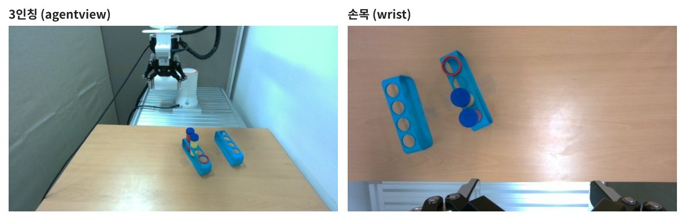
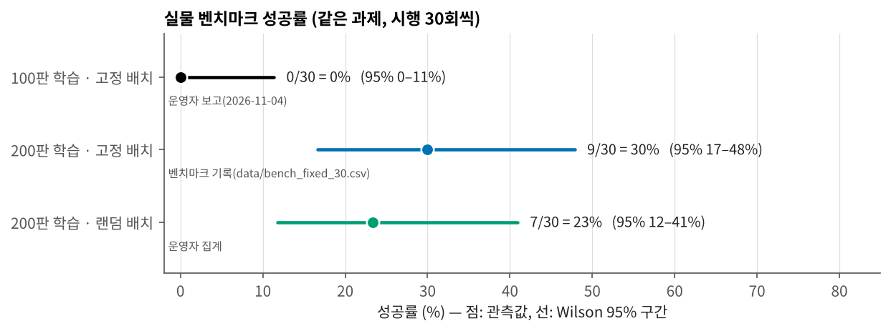
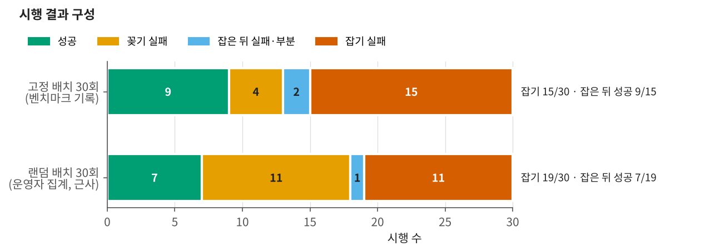
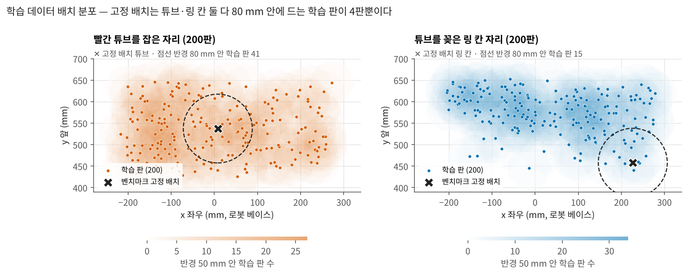

# BioRoboticsRealFR5

실물 FAIRINO FR5로 실험용 튜브를 받침의 지정 칸에 옮겨 꽂는 과제를 다룬다.
자동 수집기로 모은 200판으로 GR00T N1.7을 미세조정하고, 실물에서 60회 평가했다.

```
put the red tube in the red slot
```

4구 받침에서 빨간 액체 튜브를 뽑아, 빨간 링으로 표시한 빈 칸에 꽂는다. 같은 받침에 노란 튜브가 하나 더 있다.
튜브 지름은 28.6 mm, 구멍 지름은 30 mm다. 받침 두 개의 자리와 방향, 튜브 칸, 링 칸은 판마다 바뀐다.



---

## 결과

| | |
|---|---|
| 데이터 | 200판 / 43,968 프레임 / 10 Hz, 전부 자동 수집 |
| 정책 | GR00T N1.7 (3B), 20,000 스텝, batch 16, 행동 16개씩 |
| **고정 배치** | **9 / 30 = 30 %** (95 % 17–48 %) |
| **랜덤 배치** | **7 / 30 = 23 %** (95 % 12–41 %), 배치 10개 × 3회 |
| 이전 100판 정책 | 0 / 30 (고정 배치, 시험 자리가 학습 분포 밖) |
| 고정 배치 실패 | 빈손으로 닫음 14회 — 튜브보다 로봇 쪽으로 약 18 mm 앞에서 닫았다 |
| 랜덤 배치 실패 | 잡은 뒤 칸을 빗나감 약 11회, 잡기 실패 약 11회(배치 4개에 몰림) |





고정 배치 수치는 벤치마크 도구가 남긴 기록(`data/bench_fixed_30.csv`)에서 계산했다.
랜덤 배치와 이전 100판 결과는 운영자가 집계한 값이고, 판별 기록 파일은 없다.

**정리하면**

- 데이터를 100판에서 200판으로 늘리고 배치를 고르게 바꾸자(배치 추천) 0 / 30이 20–30 %대로 올라갔다.
  고정 배치와 랜덤 배치의 차이는 시행 30회씩으로는 가를 수 없다(피셔 정확검정 p = 0.77).
- 고정 배치에서는 실패의 절반이 잡기였다. 잡은 15회 중 9회는 끝까지 성공했다.
  빈손으로 닫은 14회는 모두 튜브에서 14–30 mm 떨어진 곳에서 닫았고, 대부분 로봇 쪽(−y)으로 치우쳤다.
- 랜덤 배치에서는 잡은 뒤 꽂기에서 더 많이 잃었다. 잡기 실패는 세 번 다 실패한 배치 4개에서 거의 다 나왔다.



고정 배치의 튜브 자리는 학습 분포 한가운데지만, 링 칸 자리는 분포 가장자리다.
튜브와 링 칸이 둘 다 80 mm 안에 드는 학습 판은 200판 중 4판이었다.

---

## 문서

| | |
|---|---|
| [docs/SETUP.md](docs/SETUP.md) | 로봇·그리퍼·카메라·받침, 컴퓨터 구성, 좌표계, 명령 경로 |
| [docs/DATA.md](docs/DATA.md) | 과제 정의, 자동 수집, 200판 분포와 점검 |
| [docs/TRAINING.md](docs/TRAINING.md) | 변환·학습 설정과 명령, 로봇 없이 한 확인 |
| [docs/BENCHMARK.md](docs/BENCHMARK.md) | 평가 방법, 고정·랜덤 결과, 실패 분석, 한계 |
| [docs/ISSUES.md](docs/ISSUES.md) | 평가 중 생긴 문제와 해결 |

## 파일

```
data/   train_layouts.csv     학습 200판 배치(튜브 자리·링 칸·받침 자세·길이)
        bench_fixed_30.csv    고정 배치 30회 판별 표(단계·실패 유형·닫은 자리)
        bench_random_30.csv   랜덤 배치 30회 운영자 집계
        bench_summary.csv     조건별 성공 수
        frames/               학습 판 예시 사진(3판 × 4장 × 두 카메라)
fig/                          그림 (tools/make_figures.py 로 다시 만든다)
tools/  fr5_to_gr00t.py       기록 원본 → GR00T(LeRobot v2.1) 변환
        fr5_rack_config.py    GR00T 모달리티 설정
        train_fr5.sh          미세조정 실행
        fr5_policy_server.py  정책 서버(HTTP /act)
        fr5_policy_try.py     실물 평가 클라이언트(제어 PC) — 단계 자동 판정·기록
        grip_udp.py           그리퍼 명령 경로 진단
        make_figures.py       그림 생성
```

그림을 다시 만들려면

```bash
python3 tools/make_figures.py
```

`fr5_policy_try.py`와 `grip_udp.py`는 제어 PC에 설치된 자동 수집기(fr5auto)의 실행기·기구학·인식 모듈을 가져다 쓴다.
fr5auto는 별도 저장소(FR5-AutoCollect)로 공개한다.

## 관련 저장소

| | |
|---|---|
| [FR5-GR00T-Benchmark](https://github.com/SungjinDavidLee/FR5-GR00T-Benchmark) | 같은 FR5로 한 이전 과제(그릇 집어 접시에 놓기) 평가, 13 / 30 |
