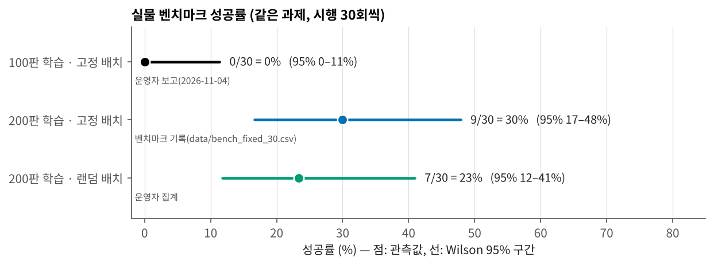
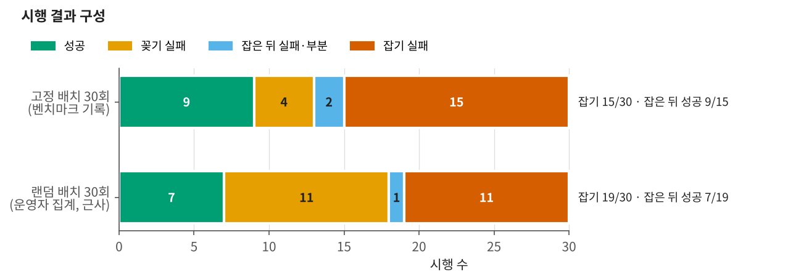
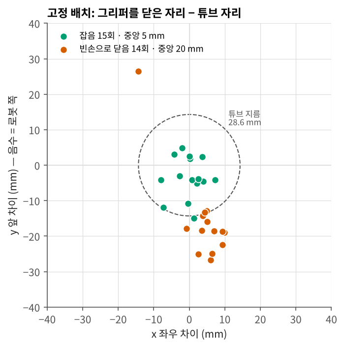

# 실물 평가

평가일 2026-11-06 · 체크포인트 `fr5_rack_v2/checkpoint-20000` (200판, 20,000 스텝)

## 1. 평가 도구

제어 PC에서 `tools/fr5_policy_try.py run --layout N`으로 한 판씩 돌렸다. 한 판은 이렇게 진행된다.

1. 초기 자세, 그리퍼 완전 열림에서 시작한다(학습 판과 같은 시작 상태).
2. 3인칭 화면으로 시작 장면을 인식해 튜브 자리와 링 칸을 기록한다. 이 인식은 판정에만 쓰고 정책에는 주지 않는다.
3. 정책 서버에 두 화면과 손끝 자세를 보내 행동 16개를 받는다. 앞 8개(0.8 s)를 실행하고, 실행이 끝나기 전에 다음 묶음을 미리 묻는다.
   묶음이 바뀌는 곳은 6스텝에 걸쳐 섞어 이어 붙인다.
4. 각 행동을 역기구학으로 관절 목표로 바꾸고 안전 검사를 한다. 걸린 묶음은 보내지 않고 다시 묻는다(연속 3번이면 판을 멈춘다).
5. 그리퍼: 정책이 낸 그리퍼 값이 0.034 아래로 내려가는 첫 스텝에서 팔을 세우고 끝까지 닫는다. 쥔 뒤에는 0.020 위로 올라가는 첫 스텝에서 연다.
   닫았는데 빈손이면 그 판을 끝낸다.
6. 놓고 2.5 s가 지나거나 120 s가 되면 끝낸다. 끝 장면을 인식해 단계를 자동 판정하고, 사람이 확인해 확정한다.

| 단계 | 자동 판정 기준 (10 Hz 실측 + 시작·끝 장면) |
|---|---|
| 잡기 | 닫고 3 s 뒤 손가락 폭 20–50 mm |
| 들기 | 쥔 채 30 mm 넘게 올라감, 도중에 손가락이 닫히지 않음 |
| 칸 위로 | 쥔 동안 손끝이 링 칸 중심 20 mm 안을 지남 |
| 꽂기 | 링 칸 14 mm 안에서 학습 시연의 놓는 높이 + 12 mm 아래로 내려감 |
| 놓기 | 쥔 뒤 그리퍼를 엶 |
| 끝 장면 | 끝 장면에서 빨간 튜브가 링 칸 14 mm 안 |

링이나 튜브를 장면에서 못 찾은 판은 해당 단계를 자동으로 정할 수 없어서 사람이 판정했다.

## 2. 조건

| | 고정 배치 | 랜덤 배치 |
|---|---|---|
| 배치 | 한 배치를 30회 반복 | 배치 10개 × 3회 |
| 튜브 자리 (베이스 mm) | (8, 537) | 판마다 다름 |
| 링 칸 자리 | (227, 458) | 판마다 다름 |
| 기록 | 벤치마크 도구 기록 (`data/bench_fixed_30.csv`) | 운영자 집계 (`data/bench_random_30.csv`) |

실행 설정은 두 조건이 같다: 속도 ×1.0(10 Hz), 묶음마다 8스텝 실행, 섞기 6스텝, 한 스텝 이동 30 mm·회전 8° 상한.

고정 배치 주변의 학습 판 수(그림은 [DATA.md](DATA.md) 그림 1):

| 반경 | 튜브 자리만 | 링 칸 자리만 | 둘 다 |
|---|---|---|---|
| 50 mm | 17 | 8 | 1 |
| 80 mm | 41 | 15 | 4 |

## 3. 결과

| 조건 | 성공 | 성공률 (Wilson 95 %) |
|---|---|---|
| 고정 배치 | 9 / 30 | 30 % (17–48 %) |
| 랜덤 배치 | 7 / 30 | 23 % (12–41 %) |
| 참고: 100판 정책, 고정 배치 | 0 / 30 | 0 % (0–11 %) |

고정과 랜덤의 차이는 피셔 정확검정 p = 0.77로, 30회씩으로는 다르다고 할 수 없다.
100판 정책의 0 / 30은 시험 배치가 학습 분포 밖이었던 조건이라 같은 저울로 비교하기는 어렵다.

### 3.1 고정 배치 30회

| 결과 | 횟수 |
|---|---|
| 성공 | 9 |
| 잡기 실패 — 빈손으로 닫음 | 14 |
| 잡기 실패 — 잡기 전에 사람이 멈춤 | 1 |
| 놓았지만 칸에 안 들어감 | 4 |
| 부분 — 놓았으나 덜 꽂힘 | 1 |
| 잡은 뒤 떨어뜨림 | 1 |

잡기는 15 / 30, 잡은 뒤 끝까지 성공은 9 / 15였다. 성공한 판의 실행 시간은 중앙 33 s로, 학습 시연(중앙 22 s)보다 길다.

**빈손으로 닫은 자리.** 그리퍼를 닫은 순간의 손끝 자리를 시작 장면에서 인식한 튜브 자리와 비교했다.

| | 횟수 | 튜브 자리와의 거리 중앙 | 앞뒤(y) 차이 중앙 |
|---|---|---|---|
| 잡음 | 15 | 5 mm | −4 mm |
| 빈손으로 닫음 | 14 | 20 mm (14–30) | −19 mm |

빈손으로 닫은 14회 중 13회가 튜브보다 로봇 쪽(−y)에서 닫았다. 튜브 지름이 28.6 mm라 중심에서 15 mm 넘게 벗어나면 손가락 사이에 들어가지 않는다.
정책이 이 배치에서 튜브까지 덜 뻗는 쪽으로 일정하게 치우쳐 있었다는 뜻이다.
고정 배치의 튜브 자리는 학습 판이 많은 곳이지만, 링 칸까지 함께 놓고 보면 비슷한 학습 판이 4판뿐이라 이 조합에서 위치가 덜 정확했을 수 있다 [추론].

### 3.2 랜덤 배치 30회 (운영자 집계)

| 배치 묶음 | 배치 | 시행 | 성공 | 실패 |
|---|---|---|---|---|
| 성공이 나온 배치 | 6 (2회 성공 1, 1회 성공 5) | 18 | 7 | 약 11 — 잡았지만 꽂을 때 칸을 빗나감 |
| 세 번 다 실패한 배치 | 4 | 12 | 0 | 약 11 — 근처까지 갔지만 못 잡음, 1 — 잡은 뒤 실패 |

잡기는 약 19 / 30, 잡은 뒤 성공은 약 7 / 19다.
잡기 실패는 배치에 묶여 있었다. 같은 배치에서 세 번 다 근처까지 가서 놓쳤다면 무작위 흔들림보다 그 자리에서의 일정한 어긋남이다.
반대로 잡을 수 있었던 배치에서는 꽂기에서 많이 잃었다. 구멍과 튜브의 틈이 한쪽 0.7 mm 정도라, 손끝 위치가 조금만 어긋나도 칸 둘레에 걸리기 쉽다 [추론].

## 4. 해석

| 실패 | 어디서 | 가리키는 것 |
|---|---|---|
| 잡기 실패 | 고정 배치 15회, 랜덤은 배치 4개에 몰림 | 배치(튜브·링 칸 조합)에 따라 손끝 위치가 일정하게 어긋남. 그 조합 근처의 학습 판이 적다 |
| 꽂기 실패 | 고정 4–5회, 랜덤 약 11회 | 칸 위치를 mm 단위로 맞추는 정밀도의 한계. 학습 시연 자체는 링 칸에 맞게 꽂혀 있었다(DATA.md 링 칸 점검) |

## 5. 한계

- 랜덤 배치와 100판 결과는 판별 기록 파일 없이 운영자가 집계했다. 랜덤 배치의 실패 내역은 근사다.
- 시행 30회씩이라 구간이 넓다(±15 %p 안팎).
- 평가 중 3인칭 밝기가 수집 때보다 높았다(약 200 대 147). 이 차이의 영향은 따로 재지 않았다.
- 고정 배치의 닫은 자리 비교는 시작 장면 인식(튜브 자리)을 기준으로 했다. 인식 자체의 오차(몇 mm)가 들어 있다.

## 6. 다음에 할 일

- **잡기:** 잡기에 실패한 배치 조합 근처에서 시연을 더 모은다. 자동 수집기의 배치 추천에 "튜브·링 칸이 함께 드문 조합"을 우선하는 항을 넣는다.
- **꽂기:** 링 칸 근처 시연을 늘리고, 마지막 접근을 느리게 해 본다. 그래도 안 되면 정책은 칸 위 몇 cm까지만 맡고, 마지막 정렬·삽입은 카메라로 잰 위치로 하는 동작으로 나누는 구성을 검토한다.
- **평가 기록:** 랜덤 배치도 평가 도구로 기록해 배치 좌표와 단계별 수치를 남긴다. 그래야 배치마다 학습 판 이웃 수와 성공을 나란히 볼 수 있다.
