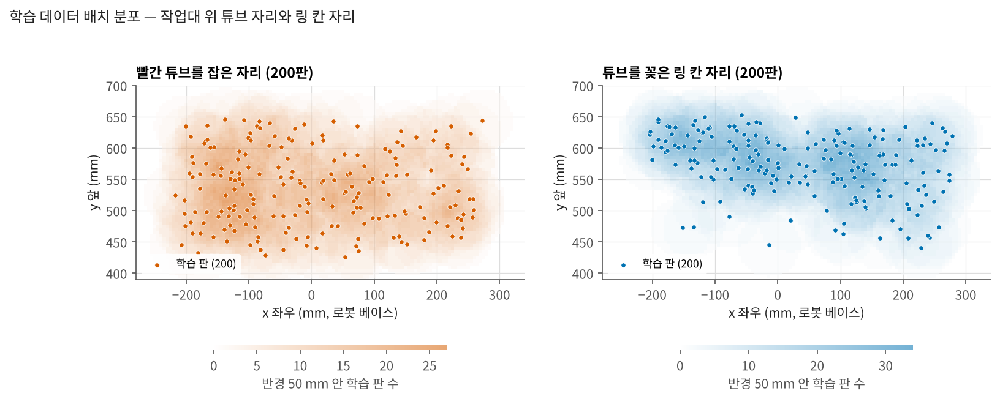
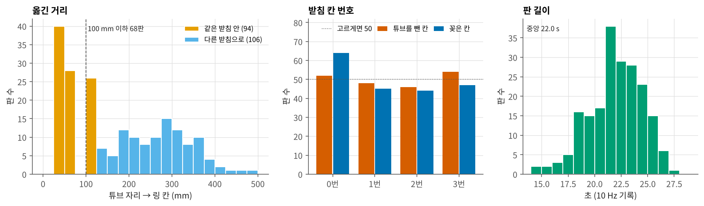
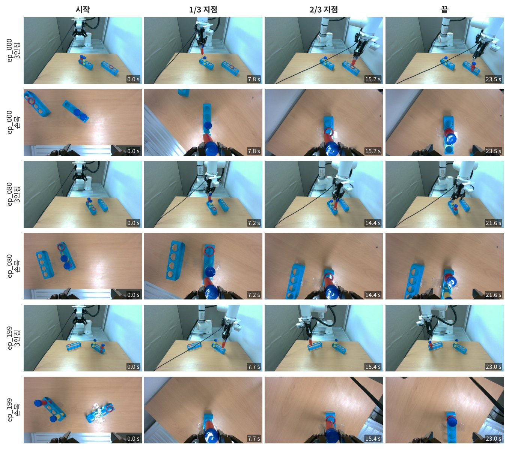
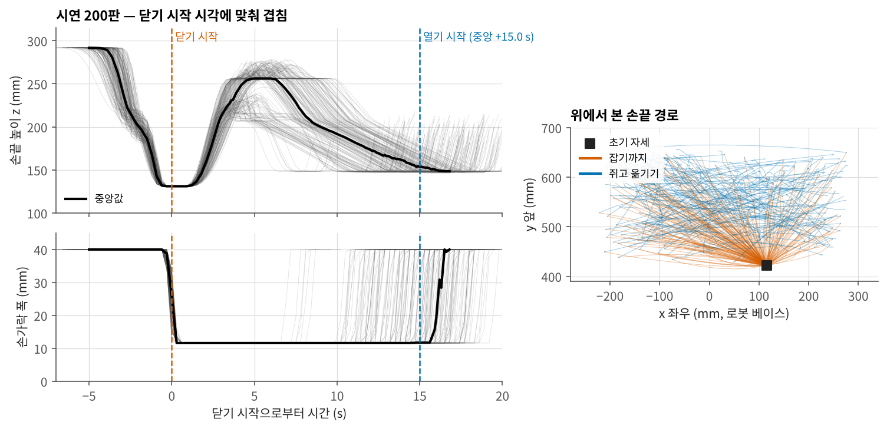

# 데이터

## 과제와 성공 기준

빨간 튜브를 꽂혀 있던 칸에서 뽑아, 빨간 링이 놓인 빈 칸에 꽂는다. 지시문은 판마다 같다.

```
put the red tube in the red slot
```

- 빨간 튜브와 노란 튜브는 같은 받침에 있다. 링 칸은 다른 받침일 수도, 같은 받침의 빈 칸일 수도 있다.
- 성공: 튜브가 링 칸에 들어갔다. 꽂는 동안 받침이 조금 밀리는 것은 괜찮다(8 mm·5° 안).
- 실패: 받침이 그보다 많이 밀렸거나, 튜브를 뺄 때 받침이 같이 들렸거나, 칸에 들어가지 않았다.

## 자동 수집

200판 모두 제어 PC의 자동 수집기 fr5auto로 모았다. 사람은 판마다 물건 자리만 바꾸고, 잡기부터 꽂기까지는 로봇이 혼자 한다.

| 사람 | 로봇(fr5auto) |
|---|---|
| 화면에 나온 추천 배치대로 받침 둘, 튜브 둘, 링을 놓는다 | 밝기 맞춤 → 3인칭·손목 화면에서 받침·구멍·튜브 색·링 칸 인식 → 궤적 계획 |
| [파악] → 계획 그림 확인 → [한 판 시작] | 녹화 시작 → 잡기 → 들기 → 옮기기 → 꽂기 → 녹화 멈춤 → 초기 자세 |
| 판정이 이상할 때만 고친다 | 끝 장면으로 판정 → 성공이면 저장, 아니면 버림 |

- 가르치기 단계가 없다. 카메라–로봇 보정과 잡는 높이는 이미 모은 판의 기록에서 계산한다.
- 궤적은 판마다 무작위 요소(접근 높이·호·속도·멈춤)를 넣어 만든다. 판마다 쓴 값은 기록 꼬리표에 남는다.
- 수집 기간: 2026-11-03 ~ 11-05. 실패·불확실 판은 저장하지 않았다.

### 100판(v1) → 200판(v2)

처음 모은 100판(v1)으로 학습한 정책은 랜덤 배치 30회에서 한 번도 성공하지 못했다(운영자 보고). v1의 배치를 점검해 보니 치우쳐 있었다.

| | v1 100판 | v2 200판 |
|---|---|---|
| 튜브 자리 ↔ 링 칸 좌우 상관 | −0.81 | 0.00 |
| 100 mm 이하로 가까이 옮긴 판 | 0판 | 68판 (34 %) |
| 옮긴 거리 중앙 | 232 mm | 145 mm |
| 서로 다른 튜브 자리 / 링 자리 (12 mm 묶음) | 32 / 43 | 145 / 140 |

v1에서는 튜브가 왼쪽이면 링은 거의 항상 오른쪽이었다. 이런 데이터에서는 링을 보지 않고 튜브 자리만으로도 꽂을 쪽을 맞힐 수 있어서, v2는 이 상관을 없애는 쪽으로 모았다.
v2는 fr5auto에 배치 추천을 넣어, 다음 판에 받침·튜브·링을 어디에 놓을지 계산해 화면에 그려 주고 그대로 놓게 했다.
추천은 빈 자리 채우기, 튜브 자리와 링 칸 사이 상관 없애기, 칸 번호·이동 종류 고르게 하기를 함께 노린다.

## 200판 분포

| | |
|---|---|
| 판 / 프레임 | 200판 / 43,968 프레임 (학습에는 판마다 마지막 프레임을 뺀 43,768) |
| 판 길이 | 5 · 50 · 95 % = 17.8 · 22.0 · 25.6 s, 10 Hz, 끊김 없음 |
| 튜브를 잡은 자리 | x −218 ~ 272, y 425 ~ 646 mm |
| 링 칸 자리 | x −204 ~ 279, y 440 ~ 652 mm |
| 옮긴 거리 | 37 ~ 488 mm, 중앙 145 mm |
| 같은 받침 안에서 옮김 | 94판 |
| 튜브를 뺀 칸 번호 0 / 1 / 2 / 3 | 52 / 48 / 46 / 54 |
| 꽂은 칸 번호 0 / 1 / 2 / 3 | 64 / 45 / 44 / 47 |



**그림 1.** 학습 200판의 튜브 자리(왼쪽)와 링 칸 자리(오른쪽). 바탕색은 반경 50 mm 안에 든 학습 판 수다. 링 칸은 y 600 근처에 많다.



**그림 2.** 옮긴 거리(같은 받침 안 / 다른 받침으로), 칸 번호, 판 길이. 100 mm 이하로 옮긴 판은 모두 같은 받침 안이다.



**그림 3.** 학습 판 3개. 판마다 위는 3인칭, 아래는 손목 화면이다.

## 시연의 움직임



**그림 4.** 시연 200판의 손끝 높이와 손가락 폭(왼쪽, 그리퍼를 닫기 시작한 시각에 맞춰 겹침)과 위에서 본 손끝 경로(오른쪽). 값은 `data/train_motion.csv`(0.3 s 간격)에서 계산했다.

| 구간 | 5 · 50 · 95 % |
|---|---|
| 시작 → 닫기 시작 | 3.9 · 5.1 · 6.6 s |
| 닫기 시작 → 열기 시작 | 10.8 · 15.1 · 18.0 s |
| 열기 시작 → 기록 끝 | 1.5 · 1.8 · 2.4 s |
| 닫기 시작 높이 z | 131 mm (모든 판) |
| 쥔 채 가장 높이 올라간 z | 223 · 265 · 276 mm |
| 열기 시작 높이 z | 147 · 148 · 149 mm |

- 닫는 높이는 판마다 거의 같다(131 mm). 접근 높이·호·속도·멈춤은 판마다 무작위로 정해서, 쥐고 옮기는 구간의 높이와 길이가 판마다 다르다.
- 손가락 폭은 다 열림 40 mm에서 튜브를 쥐면 약 12 mm가 된다.

## 링 칸 라벨 점검

정책은 링이 놓인 칸을 보고 꽂을 칸을 정해야 한다. 학습 판에서 실제로 꽂은 칸이 링 칸과 같은지 판마다 확인했다(`fr5_policy_try.py ringaudit`, 로봇 안 움직임).

| | |
|---|---|
| 첫 프레임에서 링을 다시 찾은 판 | 97 / 200 |
| 그중 링 칸과 꽂은 칸이 15 mm 넘게 다른 판 | 1 (ep_095, 73 mm) |
| 끝 프레임 빨간 튜브가 링 칸에서 15 mm 넘게 떨어진 판 | 0 / 85 |

링을 못 찾은 판도 기록된 꽂은 칸과 끝 프레임의 튜브 자리가 대부분 몇 mm 안에서 맞았다.

## 기록 형식

원본은 fr5rec 판 폴더(`meta.json` + 3인칭·손목 PNG)다. 학습용으로 GR00T가 읽는 LeRobot v2.1로 바꾼다(`tools/fr5_to_gr00t.py`).

| | |
|---|---|
| `observation.state` [11] | 손끝 x y z (m, 작업 좌표) + 회전 6D(회전행렬 첫 두 행) + 그리퍼 g, −g |
| `action` [10] | 다음 프레임 state 앞 10개. `action[t] = state[t+1][:10]` |
| `observation.images.agentview` | 3인칭, 256×256 |
| `observation.images.wrist` | 손목, 256×256 |
| 그리퍼 g | 손가락 폭(m). 다 열림 0.040, 튜브를 쥐면 약 0.012 |

회전은 축각 대신 6D로 넣었다. 축각은 각이 π 근처에서 부호가 뒤집혀 값이 튄다.
