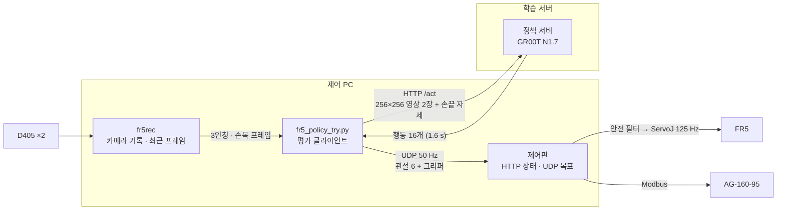

# 구성

## 하드웨어

| | |
|---|---|
| 로봇 | FAIRINO FR5 (6축), Python SDK 2.2.2 |
| 그리퍼 | DH AG-160-95 (행정 95 mm, 위치 0–1000, 1000 = 완전 열림), 힘 70 % |
| 카메라 | Intel RealSense D405 ×2 — 3인칭 고정 1대, 손목 1대, 848×480 |
| 작업대 | 900 × 600 mm |
| 받침 | 4구 받침 2개, 구멍 지름 30 mm, 구멍 간격 37.2 mm |
| 튜브 | 지름 28.6 mm, 길이 110 mm(뚜껑 포함). 빨간 액체 1개, 노란 액체 1개 |
| 목표 표시 | 빨간 링 — 꽂을 빈 칸 둘레에 올려 둔다 |

## 컴퓨터

| | 하는 일 |
|---|---|
| 제어 PC (Jetson AGX Thor) | 제어판, 카메라 기록(fr5rec), 자동 수집(fr5auto), 실물 평가(`fr5_policy_try.py`) |
| 학습 서버 (RTX PRO 6000 Blackwell ×2) | 데이터 변환, GR00T 미세조정, 정책 서버(GPU 1장) |
| 워크스테이션 | 파일 전달, 화면 보기 |

## 명령 경로

로봇에 명령을 보내는 길은 하나다. 어떤 프로그램이든 관절 목표를 UDP로 제어판에 보내고, 제어판이 안전 필터를 거쳐 `ServoJ`로 내보낸다.

- 제어판 안전 필터: 관절 속도·가속 상한, 관절 소프트 한계, 바닥 높이, 값 튐 차단, 입력이 0.3 s 끊기면 그 자리 정지.
- 그리퍼 목표도 같은 UDP 패킷에 실려 간다. 제어판이 이 값을 받아 그리퍼에 위치 명령을 낸다.
- 평가 클라이언트는 정책이 낸 손끝 자세를 역기구학으로 관절 목표로 바꾸고, 보내기 전에 안전 검사를 한다(한 스텝 이동 30 mm·회전 8° 이하, 기울기 30° 이하, 바닥 여유, 6축 회전 창).

## 좌표계

| | |
|---|---|
| 베이스 좌표 | 로봇 베이스 기준 mm. x 좌우, y 앞, z 위. 이 저장소의 배치 좌표와 그림은 모두 이 좌표다 |
| 작업 좌표 | 베이스를 z축으로 −77.2° 돌린 좌표. 정책의 상태·행동은 이 좌표의 m 단위 |
| 손끝(TCP) | 제어기 공구 설정의 손끝. 평가 클라이언트가 시작할 때 자체 기구학과 제어판 값을 비교한다(차 0.4 mm 안팎) |

## 카메라 입력

두 카메라 모두 848×480 원본을 256×256으로 비율 무시하고 줄인다(PIL BILINEAR). 학습 변환과 평가 클라이언트가 같은 방식으로 줄인다.

자동 수집 때는 판마다 시작 전에 카메라 노출을 고쳐 화면 밝기를 일정하게 맞췄다.
목표는 fr5rec 밝기 표시 기준 147이다. 평가 도구에는 이 기능이 없어서, 평가 중 3인칭 밝기는 약 200으로 수집 때보다 높았다(운영자 관찰). 평가 결과를 볼 때 감안할 조건 차이다.
